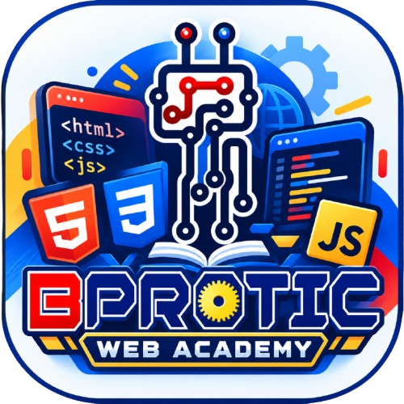

<div align="center">

  

  # BPROTIC Web Academy 🚀
  
  **Aplikasi Mobile Pembelajaran Fundamental Web (HTML, CSS, JavaScript) dengan Gamifikasi Interaktif Ala Duolingo — 100% Offline-First.**

  [](https://expo.dev)
  [](https://reactnative.dev)
  [](https://www.typescriptlang.org/)
  [](https://docs.expo.dev/versions/latest/sdk/sqlite/)
  [](#)
  [](./LICENSE)

</div>

---

## 📖 Daftar Isi

- [Tentang Proyek](#-tentang-proyek)
- [Fitur Utama](#-fitur-utama)
  - [Gamifikasi Ala Duolingo](#1-gamifikasi-interaktif-ala-duolingo)
  - [Kurikulum 4 Dunia Pembelajaran](#2-kurikulum-lengkap-4-dunia-pembelajaran)
  - [Code Playground Offline](#3-offline-code-playground-in-app-ide)
  - [Penyimpanan Lokal Persisten](#4-penyimpanan-lokal-persisten-100-offline-first)
- [Arsitektur & Teknologi](#-arsitektur--teknologi)
- [Struktur Direktori](#-struktur-direktori)
- [Panduan Instalasi & Menjalankan](#-panduan-instalasi--menjalankan)
- [Membangun File APK Standalone](#-membangun-file-apk-standalone)
- [Pemeriksaan Kode & Standar Kualitas](#-pemeriksaan-kode--standar-kualitas)
- [Kontribusi](#-kontribusi)
- [Lisensi](#-lisensi)

---

## 💡 Tentang Proyek

**BPROTIC Web Academy** dirancang untuk memecahkan hambatan terbesar bagi pemula yang ingin belajar pemrograman web di Indonesia: **ketergantungan terhadap koneksi internet yang stabil dan kejenuhan saat membaca materi teks pasif**.

Aplikasi ini mengemas seluruh materi dasar web (HTML, CSS, JavaScript modern) ke dalam **peta petualangan (roadmap) bertingkat** dengan sistem penilaian interaktif, tantangan kuis gamifikasi dengan nyawa (hearts), serta editor kode mandiri (*code playground*) yang mengeksekusi kode langsung di perangkat pengguna secara lokal tanpa memerlukan internet atau server eksternal sama sekali.

---

## 🌟 Fitur Utama

### 1. Gamifikasi Interaktif Ala Duolingo
* **Sistem Nyawa (Hearts System)**:
  * Pengguna dibekali 5 ❤️ nyawa. Setiap jawaban salah pada sesi kuis akan mengurangi 1 hati.
  * **Regenerasi Otomatis**: Nyawa pulih secara otomatis setiap 30 menit saat istirahat.
  * **Tantangan Pemulihan Nyawa (*Refill Challenge*)**: Jika nyawa habis (`0 ❤️`), pengguna dapat langsung memulihkannya hingga penuh (`+5 ❤️`) dengan menyelesaikan latihan kilat 1 soal acak.
  * **Soal Tantangan Dinamis**: Bank soal pemulihan nyawa memiliki 24+ pertanyaan bervariasi dengan mekanisme anti-duplikasi otomatis sehingga soal berganti setiap kali salah.
* **Alur Koreksi Mandiri**:
  * Ketika pengguna menjawab salah pada kuis, aplikasi **TIDAK melompati soal**. Pengguna tetap berada di nomor tersebut dengan tombol **"Coba Lagi"** agar dapat membaca pembahasan dan memperbaiki pemahamannya.
* **Progress Bar & XP Rewards**:
  * Pengguna mengumpulkan XP dari setiap materi dan kuis yang diselesaikan untuk menaikkan level pembelajar.
* **Streak Harian**:
  * Membangun kebiasaan ngoding harian dengan pelacak streak aktif yang diperbarui otomatis setiap hari.
* **10 Lencana Prestasi (Badges)**:
  * Penghargaan tersimpan di database lokal untuk berbagai pencapaian (First Step, Quiz Master, Night Owl, Persistent Coder, dll.).

### 2. Kurikulum Lengkap 4 Dunia Pembelajaran
Kurikulum disusun secara bertahap dari pemula hingga mahir dalam Bahasa Indonesia:
1. **Dunia 1: HTML Basics & Semantics** (Struktur dokumen, teks, list, multimedia, formulir, semantic tags, SEO dasar).
2. **Dunia 2: CSS Styling & Flexbox** (Selektor, Box Model, Margin & Padding, Flexbox Layout, Typography, Responsivitas).
3. **Dunia 3: JavaScript Programming** (Variabel `let`/`const`, tipe data, operator logika, manipulasi DOM, Event Listener, Async/Await).
4. **Dunia 4: Capstone Web Projects** (4 mini proyek nyata: *Personal Bio Web*, *Interactive Calculator*, *To-Do List App*, dan *Responsive Portfolio*).

### 3. Offline Code Playground (In-App IDE)
* **Editor Multi-Tab**: Tab terpisah untuk mengetik HTML, CSS, dan JavaScript secara independen.
* **Eksekusi Lokal Instan**: Kode dirender secara langsung menggunakan sandbox `WebView` lokal tanpa CDN eksternal.
* **Virtual Console**: Menangkap log `console.log()`, `console.warn()`, dan menangani runtime error JavaScript secara interaktif.
* **Template Proyek Bawaan**: Pilihan template awal untuk memulai eksperimen kode dengan cepat.

### 4. Penyimpanan Lokal Persisten (100% Offline-First)
* Didukung oleh engine database **`expo-sqlite`**.
* Seluruh data pengguna (profil nama, avatar, target menit belajar, perolehan XP, level, streak, riwayat quiz, dan status lencana) tersimpan aman di penyimpanan internal ponsel.
* Dilengkapi fitur **Reset Progres** dengan modal konfirmasi interaktif dua langkah demi keamanan data.

---

## 🛠️ Arsitektur & Teknologi

| Komponen | Teknologi yang Digunakan |
|---|---|
| **Framework Mobile** | [React Native 0.88](https://reactnative.dev/) & [Expo SDK 58](https://expo.dev/) |
| **Bahasa Pemrograman** | [TypeScript 6.0](https://www.typescriptlang.org/) (Strict Type-Checking) |
| **Navigasi & Routing** | [Expo Router v4](https://docs.expo.dev/router/introduction/) (File-based Routing) |
| **Database Lokal** | [expo-sqlite](https://docs.expo.dev/versions/latest/sdk/sqlite/) (Embedded SQLite Engine) |
| **Safe Execution Sandbox**| [react-native-webview](https://github.com/react-native-webview/react-native-webview) |
| **Ikonografi & Aset** | [@expo/vector-icons (Ionicons)](https://icons.expo.fyi/) & Brand Asset Kustom |
| **Responsivitas Layout** | Kustom `useResponsive` hook (Mobile, Tablet, Desktop Web) |

---

## 📂 Struktur Direktori

```text
src/
├── app/                         # Rute Navigasi Expo Router
│   ├── _layout.tsx              # Root Layout, Stack Nav & Inisialisasi SQLite
│   ├── index.tsx                # Gerbang utama / auto-redirect
│   ├── onboarding.tsx           # Setup profil awal & pemilihan avatar
│   ├── (tabs)/                  # Bottom Tabs Navigator
│   │   ├── _layout.tsx          # Konfigurasi custom responsive navbar
│   │   ├── index.tsx            # Dashboard Beranda & Ringkasan Belajar
│   │   ├── learn.tsx            # Roadmap Jalur Pembelajaran 4 Dunia
│   │   ├── playground.tsx       # Offline Code Playground (Editor & Sandbox)
│   │   ├── progress.tsx         # Riwayat Skor, Level, dan Galeri Lencana
│   │   └── settings.tsx         # Manajemen Profil, Preferensi & Reset Data
│   ├── lesson/
│   │   └── [id].tsx             # Reader Materi Pelajaran & Live Snippet Preview
│   ├── quiz/
│   │   └── [id].tsx             # Mesin Kuis Gamifikasi (Hearts, Retry, Refill)
│   └── project/
│       └── [id].tsx             # Capstone Project Workbench & Acceptance Criteria
├── components/
│   ├── ui/                      # Komponen Gamifikasi (GameButton, StatPill, Modals)
│   │   ├── FeedbackBanner.tsx   # Banner Evaluasi Benar/Salah (Coba Lagi)
│   │   ├── OutOfHeartsModal.tsx # Dialog Kehabisan Nyawa Ala Duolingo
│   │   ├── RefillChallengeModal.tsx # Modal Latihan Kilat Pemulihan Nyawa
│   │   ├── QuitConfirmModal.tsx # Konfirmasi Keluar Kuis Interaktif
│   │   └── TopHeaderStats.tsx   # Header Branding Logo & Statistik XP/Streak/Hearts
│   └── playground/              # Runner WebView & Virtual Console
├── constants/
│   ├── theme.ts                 # Design Tokens, Palet Warna 4 Dunia, Typo
│   └── badges.ts                # Spesifikasi 10 Lencana Prestasi
├── data/
│   ├── curriculum/              # Kurikulum Pembelajaran (HTML, CSS, JS)
│   │   └── refillChallenges.ts  # Pool 24 Soal Latihan Pemulihan Nyawa
│   ├── projects/                # Spesifikasi 4 Capstone Web Projects
│   └── playgroundTemplates.ts   # Template Eksperimen Playground
├── database/
│   ├── db.ts                    # Koneksi & Migrasi Tabel SQLite
│   └── repository.ts            # Data Access Layer (CRUD Repository)
├── services/
│   ├── gamification.ts          # Rumus Level, Perhitungan Streak, Badge Engine
│   └── quizEngine.ts            # Validator Jawaban 5 Tipe Soal
└── types/
    └── index.ts                 # TypeScript Interface & Type Definitions
```

---

## 🚀 Panduan Instalasi & Menjalankan

### Prasyarat
- [Node.js](https://nodejs.org/) versi 18 atau lebih baru.
- Manajer paket `npm` atau `bun`.
- Aplikasi **Expo Go** di HP Android/iOS (untuk testing lokal) atau Android Studio Emulator.

### Langkah-Langkah

1. **Clone Repositori**:
   ```bash
   git clone https://github.com/Farrassubahan/FundamentalWeb---app.git
   cd FundamentalWeb---app
   ```

2. **Pasang Dependensi**:
   ```bash
   npm install
   ```

3. **Jalankan Server Development**:
   ```bash
   npx expo start
   ```

4. **Jalankan di Platform Tertentu**:
   - Tekan `a` untuk membuka di **Android Emulator / Perangkat Android**.
   - Tekan `w` untuk membuka di **Web Browser**.
   - Tekan `i` untuk membuka di **iOS Simulator** (khusus macOS).

---

## 📦 Membangun File APK Standalone

Aplikasi ini dapat dibundel menjadi file APK mandiri (Standalone) yang bisa langsung diinstal di perangkat Android tanpa koneksi Expo Go:

```bash
# 1. Pastikan EAS CLI terpasang dan login ke akun Expo
npx eas-cli login

# 2. Jalankan build APK standalone
npx eas-cli build --profile preview --platform android
```

File `.apk` yang dihasilkan siap didistribusikan dan diuji dalam kondisi **Mode Pesawat (Airplane Mode / 100% Offline)**.

---

## 🧪 Pemeriksaan Kode & Standar Kualitas

Sebelum merilis perubahan ke repositori, seluruh kode harus lolos validasi ketat:

```bash
# Typecheck TypeScript (Strict, 0 error)
npx tsc --noEmit

# Linter Standar Expo & React 19 (0 warning, 0 error)
npx expo lint

# Diagnostik Dependensi & Environment
npx expo-doctor
```

---

## 🤝 Kontribusi

Kontribusi, perbaikan bug, dan penambahan kurikulum materi sangat disambut!
1. Fork repositori ini.
2. Buat branch fitur baru (`git checkout -b fitur/fitur-keren`).
3. Commit perubahanmu (`git commit -m 'feat: menambahkan materi CSS Grid'`).
4. Push ke branch (`git push origin fitur/fitur-keren`).
5. Buat **Pull Request**.

---

## 📄 Lisensi

Proyek ini didistribusikan di bawah naungan **[MIT License](./LICENSE)**.  
Bebas digunakan, dimodifikasi, dan didistribusikan untuk kepentingan edukasi dan pengembangan perangkat lunak.

© 2026 **BPROTIC Educational Labs / Farras Subahan**. All rights reserved.
